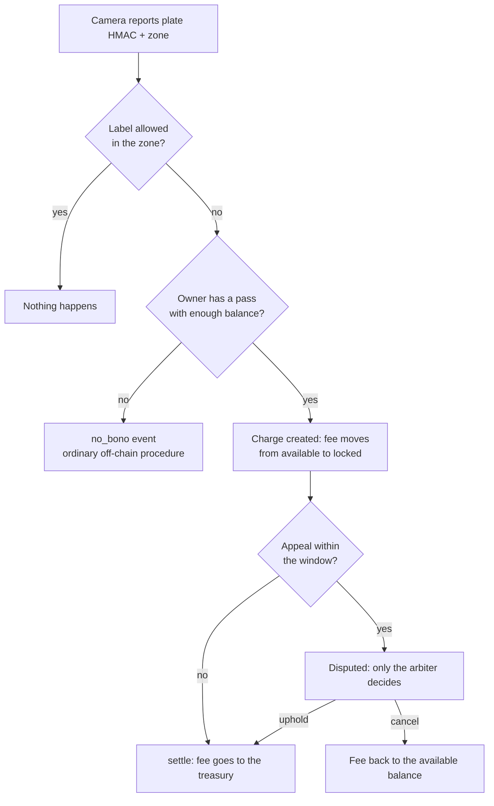
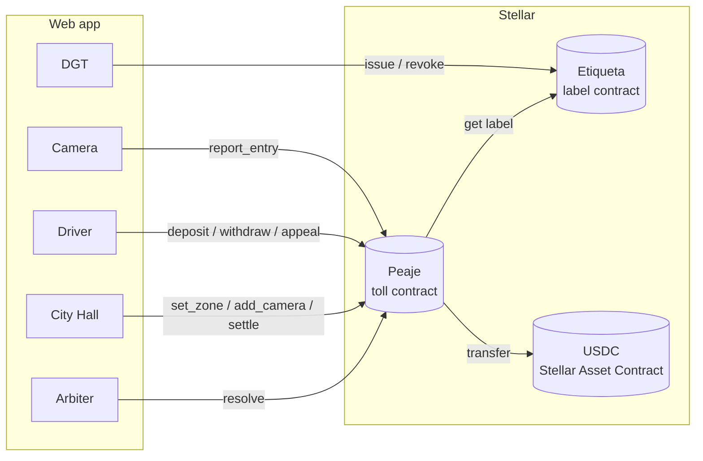

# ZBE Toll on Stellar

**An opt-in, appealable toll for Low Emission Zones, built on Stellar.**
HackMeridian 2026 · Genesis track · Team **IMPEDANCIA UNO**

🌐 **Live demo (testnet):** <https://zbe-toll.vercel.app> · demo accounts built
in, no wallet needed. Its data is **shared and persistent**: read
[Live demo (no install)](#live-demo-no-install) before trying it.

🎬 **Demo video:** [YouTube](https://www.youtube.com/watch?v=ys-ihhcaj7s) (2
min, narrated, real captures from testnet) · file:
[`video/out/demo.mp4`](video/out/demo.mp4)

📊 **Pitch deck:** [`docs/pitch-deck.pdf`](docs/pitch-deck.pdf) (12 slides)

---

## Quick start

Runs the whole demo on a local Stellar network on your machine (Linux or macOS).
No wallet extension needed.

```bash
# 1. Clone and install the prerequisites (Docker, Node, Rust, Stellar CLI…)
git clone https://github.com/marcocpp/peaje-zbe.git && cd peaje-zbe
scripts/install-prereqs.sh
# → open a new terminal afterwards (and log in again if it added you to
#   the docker group)

# 2. Terminal 1: local network + contracts + web
npm run dev

# 3. Terminal 2, once Terminal 1 shows
#    "Successfully generated client for: peaje":
scripts/zbe-setup.sh   # demo data: USDC, zone, camera, labels, demo keys
```

4. Open **http://localhost:5173** and reload it. The header pill must say
   **Local**.
5. Follow the [demo walkthrough](#demo-walkthrough): **Driver** (view as Lucía)
   → top up 20 USDC → **Camera** → plate `2222BCD` → _Car enters_ → **City
   Hall** → _Collect_ once the 60 s appeal window closes.

> `npm run dev` deploys the contracts **empty**: `zbe-setup.sh` is what
> configures them, so run it again after every redeploy. After a `git pull`, run
> `npm install` if Vite reports `Failed to resolve import`. More details in
> [Try the demo](#try-the-demo) and [Troubleshooting](#troubleshooting).

---

## Table of contents

1. [Quick start](#quick-start)
2. [The idea](#the-idea)
3. [How an entry works](#how-an-entry-works)
4. [Architecture](#architecture)
5. [Repository structure](#repository-structure)
6. [Smart contracts](#smart-contracts)
7. [Frontend](#frontend)
8. [Try the demo](#try-the-demo)
   - [Live demo (no install)](#live-demo-no-install)
   - [Option A · Local network (recommended)](#option-a--local-network-recommended)
   - [Option B · Testnet (team only)](#option-b--testnet-team-only)
   - [Demo walkthrough](#demo-walkthrough)
   - [Using your own Freighter wallet](#using-your-own-freighter-wallet)
9. [Scripts](#scripts)
10. [Testnet deployment](#testnet-deployment)
11. [Troubleshooting](#troubleshooting)
12. [Limitations and next steps](#limitations-and-next-steps)

---

## The idea

Cities across Europe are rolling out **Low Emission Zones** (in Spain, _Zonas de
Bajas Emisiones_ or **ZBE**). Access depends on the car's environmental label
issued by the traffic authority (the **DGT** in Spain): _Zero_, _Eco_, _C_, _B_
or no label. Today, a driver who enters without a valid label gets a fine weeks
later, and the city pays for a slow, expensive procedure to collect a small
amount.

**ZBE Toll** turns that into a fair, voluntary toll:

- 🪪 **Labels as tokens.** Each car's label is a **non-transferable token**
  issued by the DGT. Only the DGT can issue, reassign (e.g. when the car is
  sold) or revoke it.
- 🤝 **Consent first.** Drivers who want to pay instead of being fined top up a
  **ZBE pass** (a prepaid balance in test USDC) in the toll contract. Without a
  pass, nothing is ever charged on-chain.
- 🔒 **Lock, don't take.** When a camera reports a car whose label is not
  allowed and whose owner has a pass, the contract **locks** the daily fee. It
  is not collected yet.
- ⚖️ **Always appealable.** The driver has an **appeal window**. If they appeal,
  only an **independent arbiter** (not the city) can uphold or cancel the
  charge. If nobody appeals, anyone can **settle** it to the city treasury after
  the window closes.
- 🕶️ **Private by design.** Only an **HMAC-SHA256 of the plate** goes on-chain,
  never the plate itself, and only non-allowed entries of pass holders are
  recorded.

This is **not an automatic fine**: the pass is prior consent, funds stay the
driver's until the window closes, and the person collecting is never the person
judging.

### Why Stellar

- Labels are tokens that only the DGT can mint or move.
- Zone rules are public and verifiable on-chain.
- The locked fee sits in a contract the city cannot touch before the deadline.
- Cheap, fast transactions in a stablecoin (USDC/EURC), and Soroban smart
  contracts to encode the whole procedure.

---

## How an entry works



- **One charge per vehicle, zone and day** (like London's ULEZ daily charge). A
  second report on the same day returns the same charge.
- Charge states: `Pending` → `Settled`, or `Pending` → `Disputed` → `Settled` /
  `Cancelled`.
- Events: `charge_created`, `appealed`, `settled`, `cancelled`, `no_bono`.

---

## Architecture

There is no custom backend. Every actor is a view of the web app that signs with
its own key, and all the logic lives in two Soroban contracts.



| Actor     | Role                                          | On-chain identity in the demo                     |
| --------- | --------------------------------------------- | ------------------------------------------------- |
| DGT       | Issues environmental labels                   | `me` (admin of Etiqueta)                          |
| City Hall | Sets zone rules, authorizes cameras, collects | `me` (admin of Peaje)                             |
| Treasury  | Receives collected fees                       | `tesoreria`                                       |
| Camera    | Oracle that reports entries                   | `camara`                                          |
| Arbiter   | Independent party that resolves appeals       | `arbitro`                                         |
| Drivers   | Hold a label and, optionally, a ZBE pass      | `lucia`, `pablo`, `ana`, or your Freighter wallet |

---

## Repository structure

```
.
├── contracts/
│   ├── etiqueta/            # Label contract (Rust, soroban-sdk)
│   │   └── src/{lib,test}.rs
│   └── peaje/               # Toll contract
│       └── src/
│           ├── lib.rs       # zones, cameras, passes, charges, appeals
│           ├── dgt.rs       # interface used to call Etiqueta
│           └── test.rs      # unit tests with a test Stellar Asset Contract
├── app/                     # React + Vite frontend (Stellar Scaffold template)
│   └── src/
│       ├── pages/           # Home, Conductor (Driver), Camara (Camera),
│       │                    # Ayuntamiento (City Hall), Arbitro (Arbiter), Dgt
│       ├── zbe/             # app logic shared by the views (see Frontend)
│       ├── components/      # wallet connect, network pill (template)
│       └── providers/       # wallet and notifications (template)
├── app-lib/                 # shared lib; app-lib/clients is GENERATED, do not edit
├── scripts/                 # demo setup and helpers (see Scripts)
├── docs/
│   ├── pitch-deck.pdf       # pitch deck (12 slides)
│   └── pitch.md             # pitch script and Q&A (Spanish)
├── e2e/                     # Playwright smoke tests
├── scaffold.yml             # networks, accounts and contracts for Stellar Scaffold
└── Cargo.toml               # Rust workspace
```

> File and folder names are in Spanish (the team's language): _etiqueta_ =
> label, _peaje_ = toll, _conductor_ = driver, _cámara_ = camera, _ayuntamiento_
> = city hall, _árbitro_ = arbiter, _bono_ = pass.

---

## Smart contracts

Both contracts use `require_auth()` for every signed call, persistent storage
with `extend_ttl` for labels, passes and charges, and `#[contractevent]` events.

### `contracts/etiqueta` (admin: DGT)

| Function                             | Signed by | What it does                                                      |
| ------------------------------------ | --------- | ----------------------------------------------------------------- |
| `__constructor(admin)`               | deployer  | Sets the DGT as the only issuer                                   |
| `issue(plate_hash, owner, category)` | admin     | Issues a label (`SinEtiqueta`=0, `B`=1, `C`=2, `Eco`=3, `Cero`=4) |
| `reassign(plate_hash, new_owner)`    | admin     | Changes the owner (e.g. car sold)                                 |
| `revoke(plate_hash)`                 | admin     | Removes the label                                                 |
| `get(plate_hash) -> Option<Label>`   | read      | Category and owner                                                |

There is no transfer function for owners: the label is bound to the vehicle.

### `contracts/peaje` (admin: City Hall)

| Function                                                                              | Signed by | What it does                                                         |
| ------------------------------------------------------------------------------------- | --------- | -------------------------------------------------------------------- |
| `__constructor(admin, token, treasury, arbiter)`                                      | deployer  | Stores fixed addresses                                               |
| `set_etiqueta(etiqueta)`                                                              | admin     | Links the label contract (see note below)                            |
| `set_zone(zone_id, min_category, fee, appeal_secs)`                                   | admin     | Zone rules: free from `min_category` up, daily fee, appeal window    |
| `add_camera(camera)` / `remove_camera(camera)`                                        | admin     | Authorize / remove a camera                                          |
| `deposit(owner, amount)` / `withdraw(owner, amount)`                                  | owner     | Top up the pass / withdraw the **available** balance                 |
| `report_entry(camera, plate_hash, zone_id) -> Option<u64>`                            | camera    | Looks up the label and locks a charge if needed                      |
| `appeal(owner, charge_id)`                                                            | owner     | Appeal within the window → `Disputed`                                |
| `resolve(charge_id, uphold)`                                                          | arbiter   | Uphold (collect) or cancel a disputed charge                         |
| `settle(charge_id)`                                                                   | anyone    | Window closed, no appeal → treasury. Fails if disputed or still open |
| `balance(owner) -> Bono { free, locked }`                                             | read      | Driver's pass                                                        |
| `get_charges(owner)`, `get_charge(id)`, `list_charges(from, limit)`, `charge_count()` | read      | Charges                                                              |
| `collected()`, `get_zone(zone_id)`, `get_config()`, `is_camera(camera)`               | read      | City Hall panel                                                      |

`Category` is an ordered numeric enum, so a car enters for free when
`category >= min_category`. Peaje keeps its own copy of `Category` and `Label`
in `contracts/peaje/src/dgt.rs`, which must match `contracts/etiqueta`.

> **Why `set_etiqueta` instead of a constructor argument?** `scaffold.yml`
> cannot pass one contract's address to another contract's constructor yet
> (`${contract.…}` is reserved for a future version), so the link is made by
> `scripts/zbe-setup.sh` after deployment.

Run the tests (18 in total):

```bash
cargo test -p etiqueta -p peaje
```

---

## Frontend

React + Vite + TypeScript on top of the Stellar Scaffold template. Contract
clients are generated by Scaffold into `app-lib/clients` and imported as
`@stellar-scaffold/app-lib/clients`.

| Route           | View                                                                                                | Signs as                                      |
| --------------- | --------------------------------------------------------------------------------------------------- | --------------------------------------------- |
| `/`             | Home: the idea, roles and entry flow                                                                | —                                             |
| `/conductor`    | **Driver**: labels, ZBE pass (available / locked), top up, withdraw, charges with countdown, appeal | Your Freighter wallet, or Lucía / Pablo / Ana |
| `/camara`       | **Camera**: pick or type a plate → “Car enters”                                                     | `camara`                                      |
| `/ayuntamiento` | **City Hall**: zone rules, revenue, every charge, collect due charges                               | `me`                                          |
| `/arbitro`      | **Arbiter**: pending appeals → uphold or cancel                                                     | `arbitro`                                     |
| `/dgt`          | **DGT**: issue / revoke labels, test USDC and trustline for your wallet                             | `me`                                          |
| `/debug`        | Contract Explorer from the template                                                                 | —                                             |

`app/src/zbe/` holds the app logic:

| File                | Purpose                                                                                                                                            |
| ------------------- | -------------------------------------------------------------------------------------------------------------------------------------------------- |
| `config.ts`         | Zone, label names, USDC formatting, demo signers loaded from `app/.env.local`                                                                      |
| `contracts.ts`      | `send(tx, signer)`: signs and sends a generated-client transaction, and fails early with a readable message if simulation returns a contract error |
| `token.ts`          | USDC is a Stellar Asset Contract with no generated client: balance, mint and trustline built with the SDK                                          |
| `plates.ts`         | Browser-side HMAC of plates (same key as the scripts) and the list of known plates                                                                 |
| `hooks.ts`          | React Query reads that refresh every 3 s, countdown clock, `useAction` for writes with notifications                                               |
| `ui.tsx`, `zbe.css` | Shared components (EU-style plate, badges, page header) and the design system                                                                      |

---

## Try the demo

### Live demo (no install)

<https://zbe-toll.vercel.app> is the web app built for **Stellar testnet**
against the [deployed contracts](#testnet-deployment). Nothing to install, no
wallet needed: every view signs with built-in demo accounts.

**State is shared and persistent.** The site stores nothing of its own: every
action is a real testnet transaction. Whatever you do (top up Lucía's pass, lock
a charge, appeal, collect) stays on-chain and is what the next visitor sees.
Reloading or reopening the page does **not** reset anything. Only the extra
plates you add in **DGT** are remembered in your browser (`localStorage`) to
fill the plate lists; their labels are on-chain.

Because of that, `2222BCD` has most likely been used already today. To see the
whole flow from scratch:

1. **DGT** → issue a label for a new plate (e.g. `5678XYZ`), owner **Lucía**,
   label **B**.
2. **Driver** → _View as_ **Lucía**. If _Available_ is under 5 USDC, top up.
3. **Camera** → your new plate → **Car enters** → _Charge locked – 5 USDC_.
4. **Driver**: the charge shows **Locked** with a 60 s countdown. Press
   **Appeal** to try the arbiter path (**Arbiter** → _Cancel and refund_ or
   _Uphold and collect_), or let it expire and **Collect** it in **City Hall**.

Things to expect:

- **One charge per vehicle, zone and day (UTC).** Reporting the same plate again
  returns the existing charge, so use a new plate for each run.
- **Other people may be using it at the same time**: balances and charge lists
  can change under you (views refresh every 3 s).
- **Test money only.** USDC here is a test asset issued by the team, with no
  value. If Lucía's wallet runs out of USDC, connect your own
  [Freighter wallet](#using-your-own-freighter-wallet) on Testnet and use
  **DGT** → **Get 50 USDC**, which has no limit.
- **The demo keys are public by design** (they ship in the page). Anyone can
  sign as the camera, City Hall, arbiter or DGT, so the data may look odd if
  someone experimented. The team can restore the demo data, see
  [Keeping the live demo running](#keeping-the-live-demo-running).
- For a private, clean copy, run it on your machine with the
  [local network](#option-a--local-network-recommended).

### Prerequisites

**One command** installs everything on Linux (apt, dnf or pacman) or macOS
(Homebrew), skipping whatever is already there:

```bash
git clone https://github.com/marcocpp/peaje-zbe.git && cd peaje-zbe
scripts/install-prereqs.sh            # installs what is missing (asks for sudo)
scripts/install-prereqs.sh --check    # only reports what is missing
```

It installs:

| Tool                                                                                    | Version | Needed for                        |
| --------------------------------------------------------------------------------------- | ------- | --------------------------------- |
| git, curl, jq, openssl, C build tools                                                   | system  | Scripts, building tools           |
| Docker (and adds you to the `docker` group on Linux)                                    | system  | Local Stellar network             |
| Node.js + npm (via [nvm](https://github.com/nvm-sh/nvm) if yours is older)              | ≥ 22.12 | Frontend                          |
| [Rust](https://rustup.rs) toolchain from `rust-toolchain.toml` + target `wasm32v1-none` | 1.93.0  | Contracts                         |
| [Stellar CLI](https://developers.stellar.org/docs/tools/cli)                            | 28.1.0  | Building, deploying, scripts      |
| `stellar scaffold` plugin (`stellar-scaffold-cli`)                                      | 0.0.33  | Local network, deploy, TS clients |
| `stellar registry` plugin (`stellar-registry-cli`)                                      | 0.2.0   | Testnet names                     |
| Project npm dependencies (`npm install`)                                                | —       | Frontend                          |

Afterwards, **open a new terminal** so `cargo` and `node` are on your `PATH`. On
Linux, if it added you to the `docker` group, log out and back in (or run
`newgrp docker`) before `npm run dev`. On macOS, open Docker Desktop once so the
daemon starts.

Optional: the [Freighter](https://www.freighter.app) browser wallet, to drive
the demo with your own account.

> **Judges and anyone cloning the repo: use the local network (Option A).** It
> runs entirely on your machine with your own keys. The testnet deployment
> (Option B) is signed with the team's keys; to try it without installing
> anything, use the [live demo](https://zbe-toll.vercel.app), which ships those
> testnet demo keys, or watch the
> [demo video](https://www.youtube.com/watch?v=ys-ihhcaj7s).

### Option A · Local network (recommended)

Everything runs on your machine with Stellar Quickstart in Docker.

```bash
# Terminal 1: local network + contracts + web, with hot reload
npm run dev                       # → http://localhost:5173

# Terminal 2, once Terminal 1 shows the contracts deployed
# (“Successfully generated client for: peaje”):
scripts/zbe-setup.sh              # demo data + app/.env.local
```

Then open **http://localhost:5173** (reload it if it showed an error while the
clients were still being generated). The network pill in the header must say
**Local**. The local network needs port **8000**: if another program uses it,
the container never becomes healthy (`Health check timed out`).

What happens behind the scenes:

1. `npm run dev` first runs `scripts/zbe-init.sh`, which creates the demo
   identities (`me`, `tesoreria`, `arbitro`, `camara`, `lucia`, `pablo`, `ana`)
   if they don't exist and writes to `.env` the address of the test USDC token
   for **your** `me` account.
2. Stellar Scaffold starts the local network in Docker, funds those accounts,
   deploys Etiqueta and Peaje and generates the TypeScript clients.
3. `scripts/zbe-setup.sh` deploys the USDC test token, links Peaje to Etiqueta,
   creates the zone, authorizes the camera, issues the three labels, gives the
   drivers test USDC and writes the demo signing keys to `app/.env.local`.

`npm run dev` rebuilds and redeploys a contract whenever you save its Rust
source; run `scripts/zbe-setup.sh` again after a redeploy.

### Option B · Testnet (team only)

Uses the contracts already deployed with Stellar Registry. Writing to them needs
the team's `me` key (DGT, City Hall and token issuer). To use testnet with your
own keys, deploy your own copy (see [Testnet deployment](#testnet-deployment)).

```bash
# 1. Fund the demo accounts with Friendbot
for k in me tesoreria arbitro camara lucia pablo ana; do
  stellar keys fund $k --network testnet
done

# 2. Demo data: zone, camera, the three plates, test USDC, frontend keys
STELLAR_NETWORK=testnet scripts/zbe-setup.sh

# 3. Build the web app for testnet and serve it
scripts/zbe-build-testnet.sh
cd app && npx vite preview        # → http://localhost:4173
```

The network pill in the header must say **Testnet**.

Prefer the command line? This runs the whole flow (top up, three cars, wait for
the window, settle):

```bash
scripts/zbe-flow.sh
```

### Demo walkthrough

Demo data created by `zbe-setup.sh`:

| Plate     | Owner | Label | Role in the demo                |
| --------- | ----- | ----- | ------------------------------- |
| `1111BCD` | Ana   | Eco   | Enters for free                 |
| `2222BCD` | Lucía | B     | Has a pass → charge locked      |
| `3333BCD` | Pablo | B     | No pass → `no_bono` notice only |

Zone `centro`: **Zero and Eco** enter for free, **5 USDC** per day, **60 s** to
appeal.

1. **Driver** → _View as_ **Lucía** → amount `20` → **Top up**. Her pass shows
   20 USDC available.
2. **Camera** → plate **2222BCD** → **Car enters**. Result: _Charge #0 locked –
   5 USDC_.
3. **Driver** (Lucía): the charge shows **Locked** with a countdown; her pass
   shows 15 available / 5 locked.
4. **Camera** → **1111BCD** → _Access granted – label Eco_. Then **3333BCD** →
   _No ZBE pass or not enough balance_ (a `no_bono` event, nothing charged).
5. **City Hall**: wait until the window closes → **Collect** on the charge.
   _Collected_ and _Treasury wallet_ go up by 5 USDC.
6. **Appeal path:** issue another label for Lucía in **DGT** (e.g. `4444BCD`,
   label B), make it enter in **Camera**, press **Appeal** in **Driver** before
   the countdown ends, then **Arbiter** → **Cancel and refund** (money back to
   her available balance) or **Uphold and collect**.

> 🗓️ **One charge per vehicle, zone and day.** After a run, the same plate will
> return the _same_ charge until the next day (UTC). To rehearse again, issue a
> new plate in **DGT**, or on local reset with `stellar scaffold clean`
>
> - `npm run dev` + `scripts/zbe-setup.sh`.

### Using your own Freighter wallet

1. In Freighter, select the right network:
   - **Testnet**: built in.
   - **Local**: _Settings → Network → Add custom network_ with RPC
     `http://localhost:8000/rpc`, Horizon `http://localhost:8000`, passphrase
     `Standalone Network ; February 2017`, friendbot
     `http://localhost:8000/friendbot`, and _Allow non-HTTPS_ on.
2. **Connect** in the header, then **Fund Account** if it has no XLM.
3. **DGT** → **1 · Enable USDC** (your wallet signs the trustline) → **Get 50
   USDC**.
4. **DGT** → issue a label (owner **My wallet**, label **B**).
5. **Driver** → _View as_ **My wallet (Freighter)** → top up, then use the
   **Camera** and appeal from your wallet.

---

## Scripts

All scripts take `STELLAR_NETWORK` (default `local`). Contract IDs come from
`.scaffold/state.json` on local and from Stellar Registry elsewhere.

| Script                         | What it does                                                                                                                                                                                                                                                                     |
| ------------------------------ | -------------------------------------------------------------------------------------------------------------------------------------------------------------------------------------------------------------------------------------------------------------------------------- |
| `scripts/install-prereqs.sh`   | Installs every prerequisite (see [Prerequisites](#prerequisites)); `--check` only reports what is missing                                                                                                                                                                        |
| `scripts/zbe-init.sh`          | Runs automatically before `npm run dev`: creates missing demo identities and writes the local USDC token address to `.env` (read by `scaffold.yml` as `${env.ZBE_USDC_LOCAL}`)                                                                                                   |
| `scripts/zbe-setup.sh`         | Idempotent demo setup: deploys the USDC test asset, links Peaje → Etiqueta, creates zone `centro`, authorizes the camera, adds trustlines, mints USDC, issues the three labels, and writes `app/.env.local`. `DRIVER=G… scripts/zbe-setup.sh` also sends 50 USDC to that address |
| `scripts/zbe-flow.sh`          | Full demo flow from the CLI                                                                                                                                                                                                                                                      |
| `scripts/zbe-env.sh`           | Writes `app/.env.local` with the demo signing keys and the HMAC key                                                                                                                                                                                                              |
| `scripts/zbe-build-testnet.sh` | Builds `app/dist` against testnet and restores the local clients afterwards                                                                                                                                                                                                      |
| `scripts/zbe-common.sh`        | Shared helpers (sourced by the others)                                                                                                                                                                                                                                           |

> 🔐 **Demo-only keys.** So a single person can run the whole demo, the camera,
> City Hall, arbiter and DGT sign in the browser with test-account keys from
> `app/.env.local` (git-ignored). A real deployment would have each actor sign
> with its own wallet or backend, and no secret would reach the browser.
> `app/dist` contains those keys: do not publish it as a real service.

---

## Testnet deployment

Published with **Stellar Registry** (version 1.0.1):

| Contract              | Registry name                            | Contract ID                                                |
| --------------------- | ---------------------------------------- | ---------------------------------------------------------- |
| Etiqueta              | `unverified/zbe-etiqueta-impedancia-uno` | `CB2C4XY6HLRDE7BOZ7QH5DFST34SGDY5LVI6WA7T4X3EGXK65SO3AYSD` |
| Peaje                 | `unverified/zbe-peaje-impedancia-uno`    | `CCM6PGBSXY33ISEAWJPH2RQV2PUOLVNWKAJ37EOGJRKTIE6JF7GP3LVI` |
| USDC test asset (SAC) | —                                        | `CDB4ZZLUZQGVU6QIPVOFAUNXQFHRTMQ4NKZSIHAPT6Z3PTMM2UXB6XI2` |

Look them up by name:

```bash
stellar registry fetch-contract-id unverified/zbe-peaje-impedancia-uno \
  --source-account me --network testnet
```

To deploy your own copy (use your own team suffix):

```bash
stellar scaffold build --compile-only          # optimized wasm in target/stellar/local/
TEAM=my-team
for c in etiqueta peaje; do
  stellar registry publish --wasm target/stellar/local/$c.wasm \
    --wasm-name unverified/zbe-$c-$TEAM --binver 1.0.0 \
    --source-account me --network testnet
done
USDC=$(stellar contract asset deploy --asset USDC:$(stellar keys address me) \
  --source me --network testnet)
E=$(stellar contract deploy --wasm-hash <etiqueta hash from publish> \
  --source me --network testnet -- --admin me)
P=$(stellar contract deploy --wasm-hash <peaje hash from publish> \
  --source me --network testnet -- --admin me --token $USDC \
  --treasury tesoreria --arbiter arbitro)
stellar registry register-contract --contract-name unverified/zbe-etiqueta-$TEAM \
  --contract-address $E --source-account me --network testnet
stellar registry register-contract --contract-name unverified/zbe-peaje-$TEAM \
  --contract-address $P --source-account me --network testnet
ZBE_TEAM=$TEAM STELLAR_NETWORK=testnet scripts/zbe-setup.sh
```

Then point the `testnet` entries in `scaffold.yml` to your IDs.

> `stellar registry deploy` failed with `TxMalformed` with registry CLI 0.2.0,
> so the contracts are deployed with `stellar contract deploy` and then named
> with `register-contract`. The result in the registry is the same.

### Keeping the live demo running

For the team (needs the `me` key). The [live demo](#live-demo-no-install) uses
the testnet contracts above, so it has no reset button: charges, appeals and
deposits already made stay on-chain.

- **Restore the demo data** (zone `centro`, camera, the three labels, and up to
  20 USDC in the wallets of Lucía, Pablo and Ana). Safe to repeat:

  ```bash
  STELLAR_NETWORK=testnet scripts/zbe-setup.sh
  ```

- **XLM for fees.** Every `report_entry` that creates a charge costs about 29
  XLM of storage rent, paid by the camera account. If a view fails with
  `TxInsufficientBalance`, fund that account again:
  `stellar keys fund camara --network testnet` (same for `me`, `lucia`…).
- **Storage TTL.** Labels, passes and charges are extended to 7 days each time
  they are used. Data nobody touches for longer is archived by the network and
  has to be restored before it can be used again.
- **Redeploying the web app.** `scripts/zbe-build-testnet.sh` builds `app/dist`
  with the testnet IDs and the demo keys from `app/.env.local`; deploy that
  folder to Vercel. A new version of the contracts needs a new build.

---

## Troubleshooting

| Symptom                                                                     | Fix                                                                                                      |
| --------------------------------------------------------------------------- | -------------------------------------------------------------------------------------------------------- |
| First `npm run dev`: error overlay `Failed to resolve import "./clients"`   | Normal while Scaffold deploys the contracts and generates the clients; reload the page when it finishes  |
| `zbe-setup.sh`: “Peaje was deployed with token … but your USDC is …”        | Stop `npm run dev`, run `stellar scaffold clean`, start `npm run dev` again, then `scripts/zbe-setup.sh` |
| Blank page, Vite errors `504 (Outdated Request)`                            | Restart `npm run dev` (Vite got stuck re-optimizing dependencies)                                        |
| `Failed to resolve import "./clients"` right after `stellar scaffold clean` | Wait for `npm run dev` to regenerate the clients                                                         |
| `permission denied … docker.sock`                                           | Add your user to the `docker` group and log in again                                                     |
| “The demo key for … is missing”                                             | Run `scripts/zbe-setup.sh` (or `scripts/zbe-env.sh`) and reload                                          |
| “The toll is not linked to the label contract”                              | Run `scripts/zbe-setup.sh` after every redeploy                                                          |
| A plate returns an old charge                                               | One charge per vehicle, zone and day: use another plate or wait until tomorrow (UTC)                     |
| `TxInsufficientBalance` on testnet                                          | Fund the account again: `stellar keys fund <name> --network testnet`                                     |
| Live demo: plate already charged today, or odd balances                     | State is shared and persistent: issue a new plate in **DGT** (see [Live demo](#live-demo-no-install))    |
| Live demo: Lucía has no USDC left to top up                                 | Use your own Freighter wallet (**DGT** → _Get 50 USDC_), or the team reruns `zbe-setup.sh` on testnet    |

---

## Limitations and next steps

- **Demo signing keys in the browser.** Fine for a demo, not for production.
- **Storage rent on testnet.** Each new charge creates a few persistent entries
  (charge, daily index, owner's list); on testnet that costs around 29 XLM per
  charge. It should be measured on mainnet and optimized (e.g. a temporary daily
  index) before a pilot.
- **Simulated camera and DGT.** Real plate recognition and DGT integration are
  out of scope.
- **Next:** pilot with a city, real cameras signing their reports, DGT
  integration, multiple zones with different rules, and calling Etiqueta by name
  with `stellar_registry::import_contract!`.
